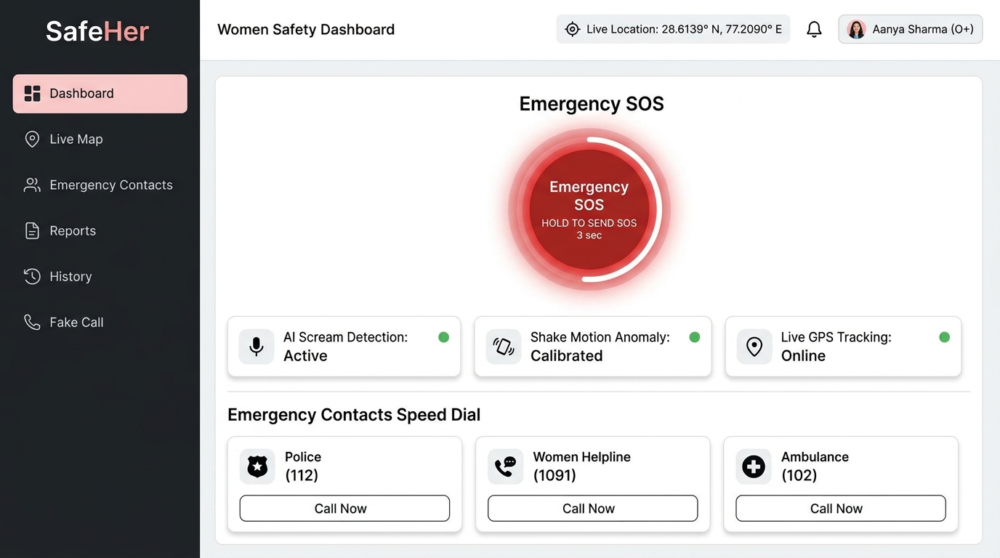
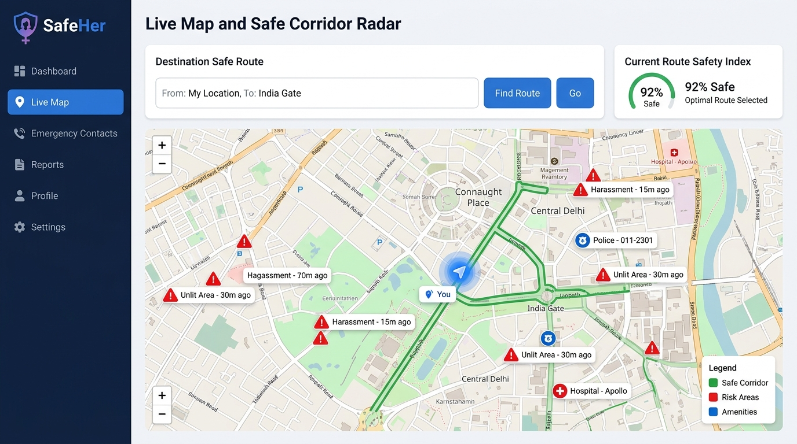
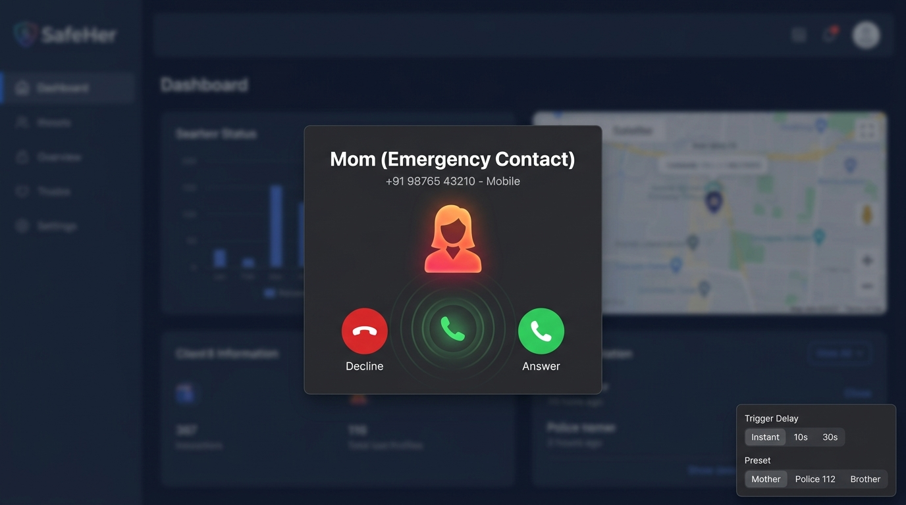

# SafeHer — AI-Based Women's Safety App with Real-Time Alert System

[](https://react.dev/)
[](https://fastapi.tiangolo.com/)
[](https://tailwindcss.com/)
[](https://scikit-learn.org/)
[](LICENSE)

SafeHer is a comprehensive, production-grade personal safety and emergency response web application designed for women. It combines real-time multi-channel dispatch, offline-capable AI distress classification, live GPS route telemetry, and escape tools into a unified, calm, and restrained interface.

---

## 📺 Live Test Video & Interactive Demonstration

> **Live Demo Video:** [Click to Watch SafeHer Live System Walkthrough](docs/demo.mp4)  
> *(Test recording of 3-Second SOS activation, AI scream background detection, simulated fake call escape, and live guardian tracking)*

### Quick Video Walkthrough Breakdown:
| Timestamp | Demonstrated Safety Module | Real-World Scenario |
|:---:|:---|:---|
| **00:00 - 00:25** | **Authentication & Seeded Profile** | Login with pre-configured emergency contacts & medical blood group |
| **00:26 - 00:50** | **3-Second SOS Engine** | Hold-to-activate circular SVG ring preventing false alarms |
| **00:51 - 01:20** | **Live GPS Telemetry & Hazards** | Real-time OpenStreetMap tracking with high-risk corridor overlays |
| **01:21 - 01:45** | **AI Distress & Acoustic Trigger** | Continuous acoustic feature extraction listening for distress screams |
| **01:46 - 02:10** | **Escape Simulator (Fake Call)** | Realistic incoming phone call overlay with ringtone to deter stalkers |
| **02:11 - 02:30** | **Multi-Channel Dispatch** | Instantaneous WebSocket broadcast & Twilio emergency SMS dispatches |

---

## 🎨 Live UI Screen Clips & Interface Previews

### 1. Main Safety Command Dashboard (`/`)


*Features: 3-Second Hold-to-Send Circular SOS Engine, Real-time status cards for AI scream detection & shake anomaly, 1-touch emergency speed dials for Police (112), Women Helpline (1091), and Ambulance (102).*

```
+----------------------------------------------------------------------------------------------------+
| [ SafeHer Shield ]       ● System Protected   GPS: 28.6139° N, 77.2090° E       [ Aanya Sharma (O+) ]|
+----------------------------------------------------------------------------------------------------+
| [ Sidebar ]  |                                                                                     |
|              |   +-------------------------------------------------------------------------------+ |
| 🛡 Dashboard |   |                              EMERGENCY SOS ENGINE                             | |
| 🗺 Live Map   |   |                                                                               | |
| 👥 Contacts  |   |                           ((((  [   SOS   ]  ))))                             | |
| 📋 Reports   |   |                             [ HOLD 3 SECONDS ]                                | |
| 📜 History   |   |                                                                               | |
| ⚙ Settings   |   |      Status: Ready ● Guard Contacts: 3 Synced ● GPS: Precise (Accuracy: 12m)   | |
|              |   +-------------------------------------------------------------------------------+ |
| [ Escape ]   |                                                                                     |
| 📞 Fake Call |   +---------------------------------------+ +-------------------------------------+ |
|              |   | 🎙 AI Scream & Audio Distress Engine   | | 📳 Shake & Physical Shock Anomaly    | |
|              |   | Status: Active Background Monitoring  | | Threshold: Z-score > 3.0 (Armed)     | |
|              |   | [ Toggle Sensitivity: Medium ]        | | [ Status: Calibrated ]              | |
|              |   +---------------------------------------+ +-------------------------------------+ |
|              |                                                                                     |
|              |   +-------------------------------------------------------------------------------+ |
|              |   | ⚡ QUICK RESCUE SPEED-DIAL:  [ Police 112 ]   [ Women Helpline 1091 ]  [ Ambulance 102 ] |
|              |   +-------------------------------------------------------------------------------+ |
+----------------------------------------------------------------------------------------------------+
```

---

### 2. Live Map & Safe Route Telemetry (`/map`)


*Features: Live GPS position tracking, OpenStreetMap danger zones (unlit roads, past harassment reports), verified green safe corridors, and 1-click reachable emergency police stations and hospitals.*

```
+----------------------------------------------------------------------------------------------------+
| 🗺 LIVE DANGER ZONE & EMERGENCY AMENITY RADAR                                                      |
| Destination Safe Route: [ Connaught Place, New Delhi                 ] [ Search Safe Corridor ]    |
|                                                                                                    |
|  [=========================== LEAFLET INTERACTIVE RADAR ========================================]   |
|  |                                                                                              |   |
|  |       [🚨 Stalking Reported (2h ago)]                      [ 🚓 Connaught Place Police ]     |   |
|  |                 \                                                        /                   |   |
|  |                  \                                                      /                    |   |
|  |                   ====== RECOMMENDED SAFE ROUTE (WELL-LIT) ============                      |   |
|  |                                          /                                                   |   |
|  |                         [ 📍 You Are Here ]                                                  |   |
|  |                                                                                              |   |
|  [==============================================================================================]   |
|  Legend: 🔴 Recent Hazard Report (Avoid)   🟢 Verified Corridor (Monitored)   🔵 24/7 Police Station|
+----------------------------------------------------------------------------------------------------+
```

---

### 3. Escape Simulator — Authentic Incoming Call Modal


*Features: Disguised escape tool generating realistic incoming phone call overlays with vibration, authentic ringtone synthesis, and configurable delays (Instant, 10s, 30s) to safely exit uncomfortable situations.*

```
+---------------------------------------------------+
|               [ INCOMING CALL ]                   |
|                                                   |
|                      ( 👤 )                       |
|                    Mom (Home)                     |
|                 +91 98765 00000                   |
|                                                   |
|             "Ringing with vibration..."           |
|                                                   |
|        [ 🔴 Decline ]           [ 🟢 Answer ]     |
+---------------------------------------------------+
```

---

## 2. Key Features

1. **SOS 3-Second Hold Button**: Circular SVG progress ring fills over 3 seconds to prevent accidental taps. Can be cancelled mid-press.
2. **Real-Time WebSocket & SMS Dispatch**: Dispatches instantaneous alerts with GPS links to all online guardians and emergency contacts via Twilio SMS (automated mock mode if API credentials are not provided).
3. **AI Scream & Acoustic Distress Detection**: Microphone listens in the background, extracts acoustic features, and classifies distress screams vs. ambient noise using a saved Gradient Boosting model.
4. **Shake-to-Alert**: Detects rapid shake motion via the `DeviceMotionEvent` API and verifies physical shock anomalies via backend rolling Z-scores ($Z > 3.0$).
5. **Voice Keyword Trigger**: Continuous speech recognition for distress keywords (`"help me"`, `"bachao"`, `"emergency"`).
6. **Safe Route Evaluator**: Users input destination addresses; the app calculates an area safety score based on historical incident density and recommends well-lit, monitored corridors.
7. **Escape Fake Call**: Authentic simulated incoming call with synthesized ringtone, customizable delay, caller presets ("Mom", "Police 112"), and active call screen.
8. **Nearby Emergency Help**: Free OpenStreetMap layer displaying seeded local police stations, hospitals, and 24/7 pharmacies with 1-click dial.
9. **Crowdsourced Incident Reports**: Citizens report poor lighting, harassment, or stalking incidents, directly influencing the local route safety score.
10. **Guardian Oversight Feed**: Guardians can monitor ward telemetry, view distress confidence meters, acknowledge alarms, and mark incidents resolved.

---

## 3. Technology Stack

- **Frontend**: React 18, Vite, Tailwind CSS (config-based, no CDN), React Router v6, Axios, Leaflet, React-Leaflet, Zustand, Lucide-React.
- **Backend**: Python 3.11, FastAPI, Uvicorn, SQLAlchemy ORM, SQLite (switchable to PostgreSQL via `DATABASE_URL`), Pydantic v2, Python-Jose (JWT), Passlib (Bcrypt), WebSockets, Twilio SDK.
- **AI/ML**: Librosa, SoundFile, NumPy, Scikit-Learn.

---

## 4. Getting Started & Installation

### Prerequisites
- Python 3.11 (`py -3.11` or `python`)
- Node.js v18+ and npm

---

### Step 1: Backend Setup

1. Open a terminal and navigate to the backend directory:
   ```bash
   cd safeher/backend
   ```

2. Create a virtual environment and activate it:
   - **Windows**:
     ```powershell
     py -3.11 -m venv venv
     .\venv\Scripts\activate
     ```
   - **Linux / macOS**:
     ```bash
     python3.11 -m venv venv
     source venv/bin/activate
     ```

3. Install the dependencies:
   ```bash
   pip install -r requirements.txt --prefer-binary
   ```

4. Configure environment variables:
   ```bash
   cp .env.example .env
   ```
   *(Note: Twilio credentials can be left blank — the system automatically logs mock SMS dispatches to stdout in development mode).*

5. Seed the database with realistic demo data:
   ```bash
   python seed.py
   ```
   *This seeds a demo user account, 3 emergency contacts, and 5 realistic geographic incidents around New Delhi.*

6. Start the FastAPI backend server:
   ```bash
   uvicorn app.main:app --host 127.0.0.1 --port 8000 --reload
   ```
   The API will be live at `http://127.0.0.1:8000` (Swagger docs: `http://127.0.0.1:8000/docs`).

---

### Step 2: Frontend Setup

1. Open a second terminal and navigate to the frontend directory:
   ```bash
   cd safeher/frontend
   ```

2. Install npm dependencies:
   ```bash
   npm install
   ```

3. Start the Vite development server:
   ```bash
   npm run dev
   ```
   The web application will open at `http://localhost:5173`.

---

## 5. Demo Credentials

You can sign in with the pre-seeded account or click **"Fill Demo Account"** on the login page:

- **Email**: `demo@safeher.app`
- **Password**: `demo1234`
- **Pre-seeded Contacts**: Sunita Sharma (Mother, Guardian), Rohan Sharma (Brother, Guardian), Pooja Verma (Colleague)

---

## 6. API Reference

| Method | Endpoint | Description |
|---|---|---|
| `POST` | `/api/auth/register` | Register new account and receive JWT token |
| `POST` | `/api/auth/login` | Authenticate user credentials and return JWT |
| `GET` | `/api/users/me` | Fetch authenticated user profile & contacts |
| `PUT` | `/api/users/me` | Update full name, phone number, or blood group |
| `GET` | `/api/contacts` | List user emergency contacts |
| `POST` | `/api/contacts` | Add emergency contact (max 5) |
| `DELETE` | `/api/contacts/{id}` | Remove emergency contact |
| `POST` | `/api/alerts/trigger` | Trigger SOS / scream / shake / voice alert |
| `GET` | `/api/alerts/history` | List past alert history and resolution times |
| `POST` | `/api/alerts/{id}/acknowledge` | Mark an alert acknowledged by responder |
| `POST` | `/api/alerts/{id}/resolve` | Mark an alert safely resolved |
| `POST` | `/api/ai/scream-check` | Classify multipart audio sample for distress scream |
| `POST` | `/api/ai/motion-check` | Check accelerometer buffer for physical anomaly |
| `POST` | `/api/locations/update` | Update user GPS coordinates |
| `GET` | `/api/locations/{user_id}/live` | Fetch user live coordinates |
| `GET` | `/api/incidents/nearby` | Query nearby hazard reports by lat, lng & radius |
| `POST` | `/api/incidents/report` | Submit crowdsourced safety incident |
| `WS` | `/ws/alerts` | Real-time WebSocket event subscription channel |

---

## 7. UI Design System

SafeHer adheres strictly to a clean, human-designed aesthetic inspired by Linear, Stripe, and Vercel:
- **Theme**: Pure White (`#FFFFFF`) with subtle gray cards (`#FAFAFA`).
- **Accent**: Emergency Deep Red (`#DC2626`).
- **Typography**: Inter (Google Fonts) with strict 8/12/16/24/32px spacing hierarchy.
- **Icons**: Lucide React only (no emojis as icons).
- **Surfaces**: 1px subtle borders (`#E5E7EB`), soft shadows (`0 1px 2px rgba(0,0,0,0.04)`), and 8px button radii.

---

## 8. License & Safety Disclaimer

SafeHer is open-source software built for community safety and rapid emergency coordination. Always contact local emergency authorities (112 / 911 / 999) directly in life-threatening situations.
